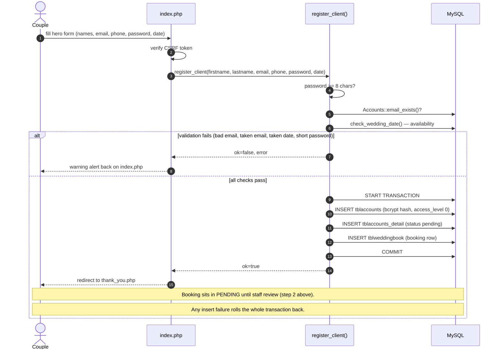
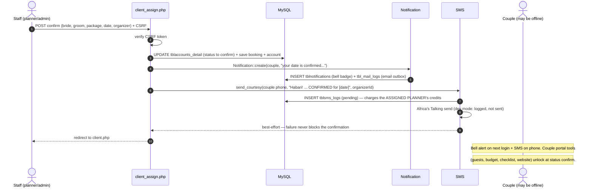
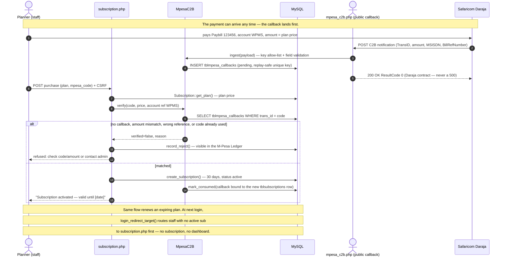

# Everafter Planner — How the System Works

A plain-English breakdown of the whole platform: who uses it, how their flows
connect, and how it makes money. For install steps see `README.md`; for
page-by-page detail see `WPMS_KENYA_MANUAL.md`.

---

## 1. The One-Sentence Summary

Everafter Planner is a Kenyan wedding-planning SaaS built in PHP/MySQL. Wedding
couples register their wedding on the public site; staff (planners and
admins) turn those registrations into managed bookings with packages, guest
lists, budgets, SMS reminders and public wedding websites; approved vendors
sell into those weddings through a marketplace; and the business earns from
staff subscriptions, vendor commissions, SMS credits and add-ons — with
M-Pesa (KSh) as the payment rail for everything.

```
Couples (public site)                Vendors (marketplace)
   │  register                          │  register → admin approval
   ▼                                    ▼
┌──────────────────────────────────────────────────────┐
│ STAFF BACK OFFICE (planners + super admins)          │
│ clients → bookings → guests/budget/calendar/gallery  │
│ SMS center · vendor ledger · subscriptions           │
└──────────────────────────────────────────────────────┘
   │                    │                       │
   ▼                    ▼                       ▼
Public wedding       SMS/e-mail               M-Pesa
websites (RSVP)      (Africa's Talking)       payments (KSh)
```

---

## 2. The Four Roles

Every role signs in through **one door** — `login.php` (the old
`admin/login.php` 301-redirects there). The system checks credentials first
against the client table (`tblaccounts`), then the staff table (`tblusers`),
then routes each account to its role's landing page.

| Role | Where they live | Access level | Lands on |
|---|---|---|---|
| **Super Admin** | `tblusers`, `access_level = 2` | Full system | `admin/dashboard.php` |
| **Wedding Planner** | `tblusers`, `access_level = 1` | Manage own clients | `admin/dashboard.php` (or `admin/subscription.php` first if no active subscription) |
| **Vendor Lead** | `tblusers`, `access_level = 0` | Own profile/services/packages/bookings | `admin/vendor_home.php` — their own bookings ledger. A business can create its own account at **`vendor_signup.php`** (public); an invited vendor with no profile yet starts at `admin/vendor_register.php` |
| **Couple / Client** | `tblaccounts` (+ `tblaccounts_detail`) | Own bookings only | `admin/client.php` — their bookings dashboard |

### Capability matrix

| Capability | Super Admin | Planner | Vendor | Couple |
|---|---|---|---|---|
| Dashboard | ✅ | ✅ | ❌ | ❌ |
| Client management | ✅ all | ✅ own | ❌ | ❌ |
| Vendor marketplace | ✅ | ✅ | ✅ own | ✅ browse/enquire |
| SMS center | ✅ | ✅ (credits) | ❌ | ❌ |
| Subscription management | ✅ | ✅ own | ❌ | ❌ |
| Admin user management | ✅ | ❌ | ❌ | ❌ |
| Vendor approval | ✅ | ❌ | ❌ | ❌ |
| Blog / real-weddings showcase | ✅ | ❌ | ❌ | ❌ |
| Budget, guest list, calendar, gallery | ✅ all | ✅ own | ❌ | ❌ |
| Planning checklist, wedding website | — | ✅ preview | ❌ | ✅ own |

**Per-planner scoping (enforced, not intent).** The "own" column above is now a
real filter: a planner sees the weddings whose `tblweddingbook.organizer_id` is
their own id **plus the ones nobody has been assigned yet** (a new booking must be
reachable so somebody can take it), and a super admin sees every wedding. It
lives in `admin/include/Helper.php` (`staff_may_open_organizer()`, the bound
`planner_scope_sql()` condition, and `booking_visible_to_session()` which every
page, sheet and MCP tool already called) and is applied by the bookings list, the
enquiries ledger (rows, status tallies and its POST handlers), the dashboard
count, the MCP tools/documents, the AI Approvals page, and — through
`admin/include/init.php` — every other staff page that names a `booking_id`.
`WPMS_PLANNER_SCOPING=0` restores the old whole-platform view; absent or empty
means ON.

### The two account tables

- **`tblusers`** — staff and vendor leads. RBAC via `access_level`
  (`2` = super admin, `1` = planner, `0` = vendor).
- **`tblaccounts`** — couples. Always `access_level = 0` and never staff.
  Client pages re-check ownership on every request and scope every query to
  the signed-in account.

---

## 3. The Wedding Lifecycle (the core flow)

```
REGISTERED ──→ PENDING ──→ ASSIGNED ──→ CONFIRMED ──→ PLANNING ──→ WEDDING DAY
   (hero form     (admin      (admin        (admin        (tools)      (budget
    on index)     reviews)    fills in      sets confirm)              closed out)
                               package,
                               organizer)
        └──→ CANCELLED / FRAUD (from review stage)
```

**Step by step:**

1. **Couple registers** on the public `index.php` hero form. The system
   validates the input (email format, uniqueness, date availability), then
   creates the client account (`tblaccounts`), client details
   (`tblaccounts_detail`, status `pending`) and a booking row
   (`tblweddingbook`) in one pass. They land on a thank-you page.
2. **Staff reviews** — pending clients queue on `admin/client.php` (Pending
   tab), with a dashboard notification.
3. **Staff assigns** — via `admin/client_assign.php`: bride/groom names,
   package (`tblweddingcategories`), wedding date, venue, and the assigned
   organizer (`organizer_id`). Status moves to `confirm` and the couple
   unlocks their portal tools.
4. **Planning phase** — both sides work in parallel:
   - *Couple portal* (`admin/client.php` + sub-pages): guest list, budget
     view, planning checklist (auto-seeded with Kenyan milestones — ruracio,
     church banns, eCitizen, committee), vendor marketplace, wedding website.
   - *Staff console*: same data with edit rights, plus package management,
     calendar (`task_calendar.php`), gallery, and the vendor enquiry ledger.
5. **Payments tracked** throughout (`tbl_liquidation`): cash, M-Pesa (with
   transaction code), or bank transfer, per event. Deposit alerts fire to the
   assigned planner; deadline-band SMS (60/30/7 days out) chase the balance to
   the couple.
6. **After the wedding** — gallery is finalized, the real wedding can be
   showcased on the blog (`tblpostwedding`), and vendor bookings marked
   completed.

### 3.1 The three key flows as sequence diagrams

These mirror the actual code paths (helper names and tables are real).
GitHub renders Mermaid natively; most Markdown viewers (VS Code, GitLab)
do too.

#### Flow 1 — Couple registration (public hero form)



#### Flow 2 — Booking confirmation (staff assigns)



#### Flow 3 — Subscription purchase & renewal (M-Pesa verified)



> With `WPMS_MPESA_VERIFY` off (dev/demo), the verification branch in Flow 3
> is skipped and the code is accepted as typed — the ledger still records
> every payment Safaricom reports.

---

## 4. How the Money Works (Monetization)

Five active streams plus three planned ones. All amounts in KSh; all payments
collected via M-Pesa (Paybill, transaction codes verified automatically via
the Daraja C2B callback — §3.1 Flow 3).

### 4.1 Staff SaaS subscriptions (the anchor stream)

Planners/admins pay monthly to use the back office. Enforced at login:
`login_redirect_target()` checks `Subscription::get_active()` and routes
staff without an active subscription to `admin/subscription.php` **before**
anything else — no subscription, no dashboard.

| Plan | Price (KSh/mo) | Weddings | Includes |
|---|---|---|---|
| Starter | 2,999 | 3 / year | Guest list, budget tracker, basic calendar |
| Professional | 7,999 | Unlimited | All features, M-Pesa, SMS, gallery |
| Agency | 14,999 | Unlimited | Multi-user, white-label, API, priority support |

Flow: pick plan → M-Pesa modal (Paybill 123456, account `WPMS`) → enter the
M-Pesa transaction code → the code is **verified automatically** against the
payment Safaricom reported to `mpesa_c2b.php` (Daraja C2B callback, see §3.1
Flow 3 and manual §7.6; with `WPMS_MPESA_VERIFY` off — dev/demo — the code is
accepted as typed) → 30-day subscription row in `tblsubscriptions`. Renewals
repeat the cycle; lapses re-route staff to the subscription page on next
login. Every reported payment is visible in the M-Pesa Ledger
(`admin/mpesa_ledger.php`), where an admin can still accept a pending one
manually.

### 4.2 Vendor commissions (transaction revenue)

Couples browse the vendor marketplace (`admin/client_vendors.php`) and send
enquiries; planners confirm deals on the staff ledger
(`admin/vendor_enquiries.php`). The confirmed amount is stored with its
commission in `tblvendor_bookings.commission`.

- **Standard vendors: 10%** of booking value
- **Premium vendors: 15%** (they pay for the extra visibility — see 4.4)

### 4.3 SMS credits (usage revenue)

Bulk SMS (invitations, RSVP reminders, harambee thank-yous, transport and
payment-deadline texts) ride Africa's Talking, with **credits charged to the
assigned planner** per send.

| Package | Credits | Price (KSh) |
|---|---|---|
| Basic | 100 | 999 |
| Standard | 500 | 2,499 |
| Premium | Unlimited/mo | 4,999 |

Cost basis: 1 SMS = 160 chars, KSh 1 per segment (long texts split via
`ceil(len/160)`). Balances tracked in `tblsms_credits`; every send logged in
`tblsms_logs` with cost and status. Auto-reminders (RSVP nudges, deadline
bands) consume the same credits, so volume scales with weddings under
management.

### 4.4 Vendor premium listings (recurring)

Vendors pay **KSh 3,000/month** for priority listing, a "Premium" badge,
unlimited photos and analytics — and pay the higher 15% commission rate.

### 4.5 Wedding websites (per-wedding add-on)

Premium feature at **KSh 1,999 per wedding**: a public shareable page
(`site.php?slug=...`) with the couple's story, venue, countdown and gallery,
plus token-based RSVP links for guests.

### 4.6 Planned / expansion streams

| Stream | Model | Price range |
|---|---|---|
| White-label license | Setup + annual | KSh 150,000 – 500,000 |
| Data / analytics reports | Per report or subscription | KSh 5,000 – 45,000/yr |
| Marketplace take-rate growth | Commission tiers by volume | negotiable |

### 4.7 Revenue at a glance

| Stream | Type | Price point | Where enforced |
|---|---|---|---|
| SaaS subscription | Monthly recurring | KSh 2,999–14,999/mo | `Subscription::get_active()` at login |
| Vendor commission | Per booking | 10–15% | `tblvendor_bookings.commission` |
| SMS credits | Usage | KSh 1/SMS | `SMS::deduct_credits()` |
| Premium vendor | Monthly recurring | KSh 3,000/mo | `tblvendors.is_premium` |
| Wedding website | Per wedding | KSh 1,999 | `tblwedding_websites` |
| White-label | Setup + annual | KSh 150k–500k | roadmap |
| Analytics | Per report / annual | KSh 5k–45k/yr | roadmap |

### 4.8 Who pays what (worked example)

A single confirmed wedding on the Professional plan, three vendor deals
confirmed at KSh 80,000 each:

| Source | Amount (KSh) |
|---|---|
| Planner subscription (Professional, monthly) | 7,999 |
| Vendor commissions (3 × 10% of 80,000) | 24,000 |
| SMS spend (200 invites + reminders @ KSh 1) | 200 |
| Wedding website (premium add-on) | 1,999 |
| **Total attributed to one wedding** | **≈ 34,200** |

Against that one wedding the vendor packages sold were KSh 240,000 — the
platform's cut is ~10% of the transaction volume it hosts, plus the fixed SaaS
floor and usage fees.

---

## 5. Supporting Modules

| Module | What it does | Key files |
|---|---|---|
| Packages | 5 Kenyan packages priced KSh 50k–350k (Ruracio 150k, Church 250k, Civil 50k, Reception 350k, After-Party 100k) with features per package | `Categories.php`, `Features.php`, `package_*.php` |
| Guest list | Kenyan-specific: harambee contributions, upcountry/transport/accommodation flags, priority A–E (VIP→general), dietary needs | `Guest.php`, `guest_*.php` |
| Budget | Payment tracking by method (cash / M-Pesa / bank) with M-Pesa codes, per-event liquidation, couple-facing "Budget vs Actual" with harambee pledges | `Liquidation.php`, `budget_*.php` |
| Calendar | FullCalendar per booking, color-coded Kenyan event types | `Events.php`, `task_calendar.php` |
| Gallery | Photo uploads per booking | `Gallery.php`, `photos_*.php` |
| Vendor services (v2.27) | What a business actually sells, as distinct from the bundle a couple buys. `tblservice_catalog` is the platform's own 39-item vocabulary across the ten categories, each with a MANDATORY unit (per guest, flat, per day, per item…) so a price is always comparable; `tblvendor_services` holds one business's rows, catalogue-derived (name and unit come from the vocabulary) or custom (the vendor types a title but still chooses a unit), with price, min/max quantity, lead time, inclusions and taste tags. Vendor → **My Services** adds, edits, prices, hides and deletes its own rows only; the couple-facing `price_line()` states the unit ("KSh 1,200 / guest (min 100)"), and the staff marketplace and couple marketplace cards and the public profile show the same line. `tblvendor_packages` is deliberately untouched: a package is a BUNDLE of services, not one, so copying packages in would list the same offer twice. Read-only everywhere except the vendor's page | `VendorService.php`, `admin/vendor_services.php`, `vendor.php`, `admin/vendors.php`, `admin/client_vendors.php` |
| Tiered pricing (v3.1) | Three levels of the same offer — **Silver, Gold, Platinum** — each with its price, what it includes and what it leaves out, on services (`tblvendor_service_tiers`) and on whole packages (`tblvendor_package_tiers`). The vendor edits them on **My Services** / **My Packages**; the save is refused unless all three are priced and Silver < Gold < Platinum, because a two-tier offer cannot be lined up against another vendor's three and a "Gold" cheaper than "Silver" is how a couple pays more for less. `tblvendor_services.price` / `tblvendor_packages.price` stay the **Silver** price and are written by the save, so every surface that already reads one number — marketplace cards, `VendorFit`, the coverage board, the vendor plan and the proposal picker — keeps working and now means "entry level"; a plain edit that posts one price is followed by `VendorTier::sync_base()` so the card cannot drift away from the cheapest level. The planner's marketplace, the couple's marketplace and the public profile print the three levels under the offering's own unit, the proposal builder lists each priced tier as its own choice, and `tblproposal_items.tier` records which level a quote line bought (a tier the vendor has not priced is refused rather than charged at Silver). Without v3.1 every page keeps quoting its single price | `VendorTier.php`, `admin/vendor_services.php`, `admin/vendor_packages.php`, `admin/vendors.php`, `admin/client_vendors.php`, `vendor.php`, `admin/proposal_view.php`, `admin/client_proposal.php` |
| Couple's vendor brief (v2.28) | The missing half of the comparison: what THIS couple wants and can spend per vendor category. `tblvendor_preferences` holds one row per (wedding, category) — taste tags, an optional floor, a cap, a note — edited by the couple (or their planner, through the same couple-page ownership gate) on **Taste & Budget**. `VendorFit` turns that into a judgement on every service, computed on read: it multiplies the unit price by a quantity it can justify (flat; guests for per-guest, using the couple's guest list or the vendor's stated minimum; the vendor's minimum for per-item/per-staff; one day for per-day) and says **Quote needed** rather than inventing a total for per-hour, per-km or an unstated quantity. States, in order: **Over budget** beats taste, then **Off your taste** (no wanted tag present), **Below your floor**, **Quote needed**, **Partly fits**, **Fits your brief**; every chip carries the arithmetic and the missing tags in its tooltip. The couple's marketplace marks each service and each vendor, offers a **Fits my brief** filter, and shows their own brief as editable chips; the planner's marketplace shows the same marks plus the couple's brief when it was opened for that wedding (the coverage board's vendor links already carry `?booking_id`), resolved through `booking_visible_to_session` so a planner cannot read another planner's couple. Nothing is stored per match, so a changed budget or re-priced service cannot leave a stale badge. The editor also **splits one total** — the package price by default, or any figure the couple types — across the categories from ten editable shares (`VendorFit::SHARES`, a starting point and not measured data): `plan_split()` apportions it with the largest-remainder method in whole KSh 500 blocks, so the caps add up to exactly what the couple has; a share of 0 means **left out**, never "clear the cap"; a floor the couple set above its share wins and the overshoot is reported rather than written below the floor. The plan is recomputed server-side from the total and the shares (never from posted amounts), previewing writes nothing, and `apply_split()` writes the caps in one transaction while leaving every taste tag, floor and note untouched | `VendorFit.php`, `admin/client_vendor_preferences.php`, `admin/client_vendors.php`, `admin/vendors.php` |
| Vendor self-registration (v2.27) | The marketplace's public front door. A business fills **`vendor_signup.php`** — the person to contact, business name/category/town/county, up to three priced services (catalogue units, so they are comparable the moment they exist) and one optional package — and `VendorSignup` writes the `tblusers` account (`access_level 0`, `email_verified 1`), an **unapproved** `tblvendors` profile, the services and the package in ONE transaction, then signs them in. The two gates answer different questions: the account works immediately (they can add services, packages and a logo from their dashboard), while `is_approved` stays 0 so the listing is invisible to couples until an operator approves it in the marketplace's "Awaiting approval" queue. A duplicate email, a nameless service, a priceless package or a missing CSRF token writes nothing at all; the public page is throttled through `SignupGuard` like planner signup. Without v2.27 the signup still creates the account and profile and says the services could not be saved | `VendorSignup.php`, `vendor_signup.php`, `vendors.php` |
| Vendor coverage | What each wedding function still needs, in one matrix: every calendar function a row, the ten vendor categories columns, and each **required** cell judged booked (a confirmed/completed deal), pending (an enquiry only) or missing, with every hole linking into the marketplace carrying the wedding and the category. Each function carries its own required list (`tblevent_vendor_needs`, v2.24), edited on the board with POST + CSRF; a function that was never edited starts from all ten, so an upgrade never hides a hole, a saved empty list means it needs nothing, and a deal in an unticked category stays visible but muted instead of counting as cover. A whole-wedding deal (`features_id` NULL) covers every row. A booked cell whose only covering vendor is also committed to another wedding that day is marked (red chip, red cell, warning list above the board naming the function, service, vendor and other wedding, and a **Double-booked cover** count in the headline cards, which opens the board filtered to just the affected functions) but still counts as booked — the deal exists, and it is what the planner has to act on. Staff only; announces nothing; writes only the requirement list | `VendorCoverage.php`, `VendorAvailability.php`, `admin/vendor_coverage.php` |
| The wedding's vendor plan (v2.29) | The question a couple asks first — *who is doing our wedding, and what does it all come to?* — answered from the deals themselves. `tblvendor_bookings` already means "this wedding chose this vendor", so the plan is a VIEW, not a table: `VendorPlan::build()` groups one wedding's deals by the ten vendor categories, splits the money three ways on purpose (**committed** = confirmed/completed, **awaiting reply** = pending, **cancelled** = kept on the record and never added), and reads each category against the cap from the couple's Taste & Budget and the whole against the package price. The only new storage is which offering a deal was made for (`service_id`, `service_qty`), so a row says "Classic buffet × 180 guests — KSh 1,200 / guest" instead of a bare figure. **Add a vendor to the plan** (POST + CSRF, staff only) creates the same pending deal a marketplace enquiry creates and bells the vendor, so the vendor sees it on My Bookings, the planner confirms the amount in Enquiries, and an availability clash is written into the deal's notes as well as shown; an offering with no published price, and a per-hour or per-km service with no quantity entered, are refused with the number they need rather than totalled at zero. Money is never recomputed: a typed amount stands, and where the vendor has since re-priced a pending service the row says "their price is now X" instead of rewriting the deal (a confirmed amount is an agreement, not arithmetic). The couple read the same figures read-only on **Vendor Plan & Total** (`client_vendor_plan.php`), caps and over-cap warnings included, and the same total is one of the **Vendor Costs** tiles on their dashboard (`client.php`) — the figure, what is left of their caps (the package price stands in until they set caps), and "over your budget" in words when it is, linking straight to the plan; staff dashboards list every wedding, so they get no such tile. Without v2.29 package deals and agreed amounts still build, the plan page names the missing migration, and the dashboard tile keeps working because the offering columns are read only when they exist | `VendorPlan.php`, `admin/vendor_plan.php`, `admin/client_vendor_plan.php` |
| The proposal lifecycle (v2.30) | A registration is the start of a conversation, not a booking. `tblproposals` holds ONE row per wedding — the couple's brief (guests, budget, venue, taste tags, a line in their words, and the planner they asked for), the planner who owns it, and a state — and the sign-up form writes it in the same request as the account and booking, so nothing has to be retyped. The seven states are `proposal`, `acknowledged`, `options`, `tweak_requested`, `chosen`, `locked`, `declined`, and each move belongs to exactly one side: the planner **acknowledges** (claims it out of the shared queue), prices **at least three options** — `tblproposal_options` + `tblproposal_items`, each line a package, a service × quantity or a custom agreed amount drawn from the same offerings the marketplace and vendor plan use, with its own total stored because an option is a QUOTE and not a live sum — **sends** them, and **locks** the couple's choice; the couple **chooses**, **asks for a change** in their own words or **declines**. Publishing is refused below three priced options, because one option is not a choice, and each option is read against the couple's budget so "KSh 340,000 of your KSh 300,000" is visible before they pick. The **lock** re-checks every vendor's listing and calendar and creates one pending deal per line through the vendor plan's own door, so every vendor is notified and the deals stay the single record of what was agreed: a refused line (vendor unapproved, service since hidden) rolls the whole thing back, and a vendor already booked that day blocks until the planner ticks "book them anyway", which records the clash on the deal. Only then does the booking become `confirm` — the same state `client_assign.php` has always written — so nothing that reads a booking status changed, and a wedding confirmed before v2.30 simply has no proposal. `WPMS_PROPOSAL_FLOW=0` turns the lifecycle off (sign-up creates the ordinary pending booking); without the migration the couple still registers and the pages name it. **The checklist follows the choice:** locking seeds the wedding's plan — the Kenyan milestone template plus one "confirm this vendor in writing" line per booked vendor (`Checklist::ensure_from_option`, in its own *Your Vendors* phase, three weeks out), because one "confirm every vendor" tick cannot stand for six suppliers. Seeding happens at lock, not on first page open, so the couple's dashboard shows real progress the moment they are confirmed; both seeders are idempotent by title, so re-running or a couple who already ticked items loses nothing. `Checklist::progress()` is the ONE calculation the checklist page and the dashboard card both render — done/total, the next open item, and overdue, which needs a wedding date to be late against (no date means nothing is overdue) and stops nagging once the wedding has passed; it only reads, so opening the dashboard can never seed, tick or reset a couple's work | `Proposal.php`, `Checklist.php`, `admin/proposals.php`, `admin/proposal_view.php`, `admin/client_proposal.php`, `admin/client_checklist.php`, `admin/client.php`, `index.php` |
| Vendor availability | Is the vendor already working another wedding that day? A deal's day is its own `event_date`, else the day of the function it is scoped to, else the wedding's; any other wedding this vendor has confirmed or completed on that day is a clash. Asked where a deal is made, not on a report: the planner's **Confirm** refuses an unacknowledged clash and records the acknowledgement (and the other wedding) in the notes trail; a couple's enquiry is still recorded but warns the couple and leads the planner's bell; a planner's marketplace inquiry writes the warning into the deal's notes; the vendor's own dashboard shows "you are also booked" before Accept and records it when they accept anyway — never blocked, because a studio with two teams knows its own capacity. Pending enquiries and cancelled deals are not commitments, two deals at ONE wedding are not a clash, and an unreadable date produces no clash rather than a guess. The coverage board marks the affected booked cells as not real cover. Read-only, no table | `VendorAvailability.php`, `admin/vendor_enquiries.php`, `admin/client_vendor_enquiry.php`, `admin/vendors.php`, `admin/vendor_home.php` |
| Reply escalation (v2.26) | The conversation made waiting visible; nothing made it heard. `scripts/thread_escalation.php` (daily, registered with `JobWatch` like every other job) finds each deal whose NEWEST message is not the vendor's and is at least a day old — the moment a couple is being kept waiting — claims it by stamping `tblvendor_messages.escalated_at` and only then rings the couple's planner, bell plus the platform's normal email, with one sentence naming the couple, the vendor and how long they have waited, linked to the thread opener so the reply is one click away. Read state is deliberately not the trigger: a vendor who opened the question and never answered is exactly who the planner needs to ring. Completed and cancelled deals, and weddings already held, are skipped; a vendor reply ends the silence, and a later message is escalated in its own turn, so the alert follows the unanswered message rather than the deal. `--hours` widens the grace, `--dry-run` reports without stamping, and the claim-before-ring order makes a re-run or a second pinger silent. | `VendorThread.php`, `scripts/thread_escalation.php`, `admin/include/JobWatch.php`, `cron_bridge.php` |
| Deal conversation (v2.25) | The couple, the vendor and the couple's planner talk on ONE thread per deal (`tblvendor_messages`) instead of writing into the deal's single `notes` column: every message carries its author's role and name, so authorship and order survive, and three read stamps on the row give each side its own unread count with no per-viewer join. Writing is one POST + CSRF door (`admin/vendor_thread_post.php`) that resolves the role from the session and re-checks ownership — the couple must own the booking, the vendor must own the listing, the planner must be able to open the deal's wedding — before storing the message and ringing the other two in-app. "Next step" is derived, never stored (`VendorThread::stage`): the couple reads "the vendor replied — your turn", the vendor reads "reply needed", the planner reads "follow up" / "loop the couple in", and a confirmed deal reads Booked for everybody, so a stage can never go stale. Each role gets quick replies (one tap on a phone), and the deal's original `notes` opens the thread as the "Original enquiry" bubble, so a deal that predates v2.25 has context immediately; `notes` itself stays the audit trail. Opening a thread goes through `admin/vendor_thread_open.php`, which authorises again, clears only that role's badge and returns to the ledger with the panel expanded — which is also where a bell link points. The sidebar carries the same count for every role (`VendorThread::unread_total`), scoped exactly like the ledger it sits on — Vendor Enquiries for staff, My Bookings for a vendor, and a "Vendor enquiries" entry for a couple that opens their own wedding's marketplace — and the badge itself opens the OLDEST unread thread (`oldest_unread`, so a queue is served oldest first) through the same opener, falling back to the ledger list when nothing is waiting. Both ledgers a role works from carry an **Unread (N)** chip (threads waiting, not messages) that filters the list to the queue — Vendor Enquiries for the planner, My Bookings for the vendor (where the chip also keeps the listing being read); it combines with the status chips instead of replacing them, the row's open link, the opener and the Accept/Decline form carry the filter back so working a thread does not lose the queue, and the deal just opened stays visible (still ownership-scoped) even though reading it removed it from the filter. The queue is served **longest waiting first** (`VendorThread::waiting_first`): each page re-orders its rows by the oldest unread message — the same (created_at, id) rule `oldest_unread` walks — so the top row is the deal the sidebar badge would have opened, a row kept only because its panel is open sinks to the bottom, and a same-second tie is broken by message id. Every row with unread words carries the duration next to its "N new" pill (`waiting 3 h`, the exact time in the tooltip, from `waiting_for`), read from the very message the order sorts on (`waiting_since`), so the label and the row's position can never disagree. | `VendorThread.php`, `include/vendor_thread_panel.php`, `admin/vendor_thread_post.php`, `admin/vendor_thread_open.php` |
| Capacity headroom | Drift, before it is a breach: the weddings whose planned headcounts are within a share (5/10/20%, ten by default) of the guest limit on a package a vendor is confirmed on. One row per wedding, tightest first, with the function, the count and the limit stated and the venue sheet linked; a wedding already over a limit is counted separately and said in red rather than dropped. Staff-only, and it announces nothing — a bell per wobble of a guest count is noise. The width an account watches at is remembered per account (POST + CSRF), not per session | `PackageCapacity.php`, `UserPrefs.php`, `headroom.php` |
| Notifications | In-app bell + email outbox (`tbl_mail_logs`), retried by `mail_retry.php`, pruned by `notify_prune.php`; every row is addressed to ONE account table (`recipient_type`, v2.13) so two accounts that share a number never share a feed | `Notification`, `scripts/mail_retry.php` |
| Automation | Cron scripts: RSVP reminders (`rsvp_reminders.php`), payment deadline SMS (`deadline_sms.php`), mail retry, notification prune, subscription renewals, demo reset | `scripts/` |
| Job health | The platform reports its own silence: every scheduled job (mail retry, notification prune, subscription renewals, RSVP reminders, payment deadline texts, AI approval expiries) leaves a heartbeat when it really runs — `tbljob_heartbeats`, one row per job (v2.15) — and `scripts/job_watch.php` judges them against the schedule each is deployed with: never run, silent past its interval + grace, failing, or 'ok' while the queue that run reported had work waiting. A job that has run and stopped rings the operator's bell (super admins, once per finding per half-day, forgotten on recovery); a job that has never run is reported and exits non-zero instead. Super admins read it as **Job Health** (`admin/job_watch.php`), which audits as it opens | `JobWatch.php`, `scripts/job_watch.php`, `admin/job_watch.php` |
| Dashboard design system (2026) | One skin for all four roles instead of four reskinned admin panels: a warm-stone neutral ramp, a rose-gold brand accent and semantic colours that each carry a text-safe ink plus a tint and a line, defined once as custom properties (``admin/css/design-tokens.css``) and consumed by the shell (`app-shell.css`: espresso sidebar, glass top bar, popovers, focus rings) and the shared components (`modern-admin.css`: cards, stat tiles, tables, buttons, forms, badges, overlays, the deal-conversation panel). A third, deliberately small sheet (`design-system.css`) is loaded *after* the page's own `<style>` so the handful of components every page redefines inline — stat tiles, filter bar, booking table, and the `.hint` / `.mono` helpers that had no rule at all — read the same everywhere; page-specific furniture stays in its page. Contrast is a rule, not a taste: `--brand-700` is the interactive shade (5.2:1 on white) while `--brand-500` is decoration and large text only (3.2:1), muted copy is a darkened stone (5.8:1), and KPI numbers are capped with `clamp()` so a long KSh figure never collides with the tile accent. Legacy variable names (`--admin-bg`, `--admin-accent`, `--app-emerald`…) point at the new tokens, so older rules pick up the palette instead of keeping slate-and-emerald. Stylesheets are revalidated rather than cached for a week, so a restyle is visible the day it is deployed | `admin/css/design-tokens.css`, `admin/css/app-shell.css`, `admin/css/modern-admin.css`, `admin/css/design-system.css`, `admin/include/sidebar.php`, `.htaccess` |
| Blog | Real-weddings showcase | `EventWedding.php`, `blog_events_*.php` |
| AI access (MCP) | An AI client (Claude, ChatGPT, Cursor, an internal agent) reads the planner over the Model Context Protocol and answers questions about real weddings — who is close, who has not RSVP'd, what is overdue, where the budget stands. A token minted on **AI Assistant** (`admin/api_tokens.php`) resolves to ONE of this platform's own accounts and every call runs with that account's session, through the same ownership predicates the pages use, so the assistant sees exactly what its human could open in a browser and never names a table or writes SQL. Tool scopes are a second ceiling under the account's powers; reads are always on, and a write has a TIER (v2.17): Tier 2 — a guest, a guest edit, an invitation, a checklist tick — needs `confirm: true` and otherwise returns a preview of exactly what would change; Tier 3 — an SMS to a guest list, a recorded payment, an M-Pesa deposit prompt, a planner assignment — sends nothing on its own authority, records a request and waits for a signed-in planner to approve that exact payload on **AI Approvals** (`admin/mcp_approvals.php`, with a sidebar badge), which mints a short-lived, single-use, HMAC-signed approval bound to the tool AND the payload hash, so a changed message or amount no longer fits and exactly one action happens once; that window does not close in silence (v2.19): `scripts/mcp_approval_sweep.php` runs every 10 minutes, closes each request that expired unanswered OR was approved and never used (marking it once with `expired_at`, so re-runs are silent and a last-second decision wins), writes one `tblapi_audit` row saying nothing ran, and rings the requesting planner's bell once with the dead references; a retry of the same call answers `previous_request_expired` naming the reference that died, and closed requests stay visible under **Decisions and expiries**; from there (v2.20) **Re-request this payload** creates a NEW pending request for the same tool and payload with a fresh 30-minute window, leaving the expired row expired and recording `re_request_of`/`re_requested_by`, so the planner can revive the action without the assistant asking again (the assistant's identical retry then lands on the new reference; the click itself approves nothing); both tiers also need `WPMS_MCP_WRITES=1`; every call is rate-limited on its own guard door (`mcp`, keyed by the token's hash) and recorded in `tblapi_audit` — refusals included, argument SHAPES only. Both MCP eras are served statelessly (legacy `initialize`, current `2026-07-28` with version/method headers that must agree with the body), and the endpoint offers all three MCP surfaces: thirteen read tools, weddings as **resources** (`wedding://{booking_id}/overview|timeline|guests|tasks|budget|capacity|vendors|website`, each one running the tool behind the same question so the two doors cannot disagree; a wedding this account may not open is reported exactly as one that does not exist, while a scope the token lacks is named because it is fixable) and four **prompts** (`weekly_wedding_brief`, `rsvp_chase_list`, `budget_watch`, `vendor_shortlist`) that gather their own context through the read tools and carry the platform's own rules and figures. Resource reads and prompt gets are audited under the same scope vocabulary and the same argument-shape rule. Reads can be moved off the primary with the optional `WPMS_DB_REPLICA_*` variables (v2.19): a configured replica is a second PDO handle used only for the read tools (the global handle is swapped for the length of one handler and restored in a `finally`), while every write, the token check, the audit row and an approval decision stay on the primary; an empty host — the normal single-database install — uses the primary for everything, and an unreachable replica falls back to it with one line in the PHP error log | `mcp.php`, `McpServer.php`, `McpTools.php`, `McpResources.php`, `McpPrompts.php`, `McpWrites.php`, `McpApprovals.php`, `ApiToken.php`, `models.php`, `admin/api_tokens.php`, `admin/mcp_approvals.php`, `scripts/mcp_approval_sweep.php` |
| Business pulse | The operator's own numbers on one page — **Business Pulse** (`admin/ops_pulse.php`, super admins): weddings upcoming and unconfirmed, package value against collected, MRR and renewals, RSVP response, overdue tasks, vendor supply, AI activity and job health, plus findings from eleven fixed rules over the same data, each with the figures that fired it and the page where a human acts. Thresholds and muted findings are per account (`tbluser_prefs`), validated on write and re-validated on read, and the AI tools `system_status`/`list_insights` use the caller's own values — so the screen, the assistant and the Monday email cannot disagree. The figures carry no customer detail by construction: internal ids and aggregates only. `scripts/business_pulse_email.php` (checked daily, sends Monday in Africa/Nairobi, once per ISO week per owner, queued in `tbl_mail_logs` while the transport is off) emails the same brief to every super admin, with `WPMS_PULSE_TO` for a shared mailbox. Each figure carries its signed change against the last snapshot taken before that week (`tblops_snapshots`, v2.23; counts, KSh and percentage points, per owner), written only after a send is accepted and kept for 26 weeks; `system_status` returns that same movement block to the assistant, with `available: false` and a reason when there is no earlier snapshot. No model is involved, so it needs no AI provider or DPIA | `OpsPulse.php`, `BusinessPulse.php`, `admin/ops_pulse.php`, `scripts/business_pulse_email.php` |

---

## 6. Data Model Map (who links to what)

```
tblusers (staff, access_level 0/1/2)
   │ organizer_id
   ├──→ tblaccounts_detail ──→ tblaccounts (couples: access_level 0)
   │            │
   │            └─ user_id ──→ tblweddingbook (bookings)
   │                              │ booking_id
   │                              ├──→ tblguest        (guests + harambee)
   │                              ├──→ events          (calendar)
   │                              ├──→ tbleventbooking (event↔feature links)
   │                              ├──→ tblgallery      (photos)
   │                              ├──→ tbl_liquidation (payments, M-Pesa codes)
   │                              ├──→ tblwedding_websites (public site, slug)
   │                              ├──→ tblvendor_preferences (v2.28: taste tags, floor,
   │                              │      cap and note per vendor category — the brief
   │                              │      the marketplaces judge services against)
   │                              ├──→ tblvendor_bookings (vendor deals, commission;
   │                                   .features_id = the function the deal covers)
   │                              └──→ tblsubscriptions? no — subscriptions key on staff
   │
   └── staff-owned
        ├──→ tblsubscriptions (+ tblsubscription_payments, plans in tblsubscription_plans)
        ├──→ tblsms_credits / tblsms_logs
        ├──→ tblvendors (vendor profiles →
        │     tblvendor_services → tblservice_catalog — what it sells, priced per unit;
        │     tblvendor_packages stays what it BUNDLES from those services)
        ├──→ tbluser_prefs  (one row per account preference; today the width the
        │     capacity headroom view opens at — validated on read, absent = default)
        ├──→ tblops_snapshots (weekly-brief history: one aggregate snapshot per
        │     account per ISO week, so the next brief prints each figure's
        │     change; written only when a send is accepted, pruned to 26 weeks)
        └──→ tblnotifications / tbl_mail_logs  (bell + email outbox: deposits,
             vendor enquiries, and the couple's headcount brief to the planner,
             the venue contact and every vendor booked on the wedding — each
             scoped to the functions their own deal covers — plus the warning
             when a function's plan outgrows the guest capacity of the package
             its vendor was booked on, tblvendor_packages.capacity — with the
             way out: that vendor's next package up and the price difference,
             which the planner applies to the deal in Vendor Enquiries. The same
             check runs when a deal is RECORDED (the couple's enquiry, the staff
             confirm, the vendor's own accept, and a scope widened onto a
             function the package cannot cover), so a package too small for a
             plan that has not changed since is caught at booking time rather
             than at the next headcount save)

tblweddingcategories (packages) ──→ tbl_features
tblpostwedding (real-weddings blog)
```

> Note: `tblsubscriptions.user_id` points at **staff** users (`tblusers`) —
> planners pay, couples don't.

---

## 7. Security & Session Model (what gates every role)

- **One login door** with CSRF-protected forms; credentials checked against
  `tblaccounts` first, then `tblusers` (bcrypt `password_verify`).
- **Session hardening**: ID regeneration on login and every 15 minutes,
  fingerprint binding, audit rows in `tblsession_audits`.
- **Role gating**: staff pages call `require_staff()`; client pages check
  `$_SESSION['id']` ownership and scope every query to the signed-in account.
- **Subscription gate**: staff without an active subscription are diverted to
  `admin/subscription.php` — the SaaS enforcement point.
- **PDO prepared statements** everywhere, CSRF tokens on all POST forms.
- **M-Pesa verification is automatic** (Daraja C2B callback, §3.1 Flow 3 and
  §9): a typed transaction code is checked against the payment Safaricom
  reported to `mpesa_c2b.php`; an operator can still accept a pending one by
  hand in the M-Pesa Ledger. With `WPMS_MPESA_VERIFY` off (dev/demo) the code is
  accepted as typed.
- **The scheduled jobs report their own silence (v2.15).** Everything above is
  a promise kept by a process nobody is standing next to: `mail_retry.php`,
  `notify_prune.php`, `subscription_renewals.php`, `rsvp_reminders.php`,
  `deadline_sms.php`, (since v2.19) `mcp_approval_sweep.php` and (since v2.26)
  `thread_escalation.php` fail the same quiet way — they stop running, so nothing is
  printed and nothing is noticed until a planner asks why their invoice email
  never came. Each job now writes a heartbeat when it really runs
  (`tbljob_heartbeats`, one row per job — a counter, not a log; `--dry-run`
  writes none, so a dry run can never make a silent job look alive), and
  `include/JobWatch.php` judges those heartbeats against the interval and grace
  each job is deployed with. Each heartbeat also carries the queue that run's
  own window held, counted by the JOB's own selection before its `--limit`
  (a copy of five different predicates in the watchdog would have been five
  places to be wrong about a job that was right). Four findings, and no more:
  **never** (no run recorded — reported and exits non-zero, never a bell: on
  install day every job is in that state), **silent** (it ran before and
  stopped), **failed** (a non-zero exit, a run that delivered nothing at all
  while rows waited, with the streak), and **idle** ('ok' while the queue IT
  reported had work — a sweep that reports success while the queue grows).
  'noop' exists for jobs that are deliberately switched off, so a job is never
  blamed for work it was told not to do. The
  operator is told once per (job, finding) per 12 hours and the memory clears
  when the job recovers, so a long outage costs one bell per half-day and the
  next silence is news again. `scripts/job_watch.php` prints the same report,
  exits `1` on a finding and `2` when the table is missing, and is what
  `cron_bridge.php` runs hourly (as `job_watch` — a finding turns the bridge's
  reply into HTTP 500 for a status monitor); **Job Health**
  (`admin/job_watch.php`, super admins) audits on open, because a watchdog that
  only runs when the scheduler is healthy could never report a dead scheduler.
  An install that wants no job alerts sets `WPMS_JOB_ALERTS=0` (the operator's
  own switch — its own, because the suite-wide `WPMS_LOGIN_THROTTLE_OFF` would
  have silenced the bell by also unlocking the login door), and only the bell
  and the email stop: the report, the non-zero exit and the page are unchanged.
  Storage: `migrations/v2.15_job_heartbeats.sql`.
- **A machine is authenticated as a person, and judged as that person (v2.16).**
  An AI client cannot hold a browser session, and handing it one would create a
  sign-in its owner could neither see nor revoke. It presents a **token**
  instead (`tblapi_tokens`): one row per token, the secret stored only as
  sha256 and shown once at mint, with its own expiry, its own scopes, an
  optional narrowing to a single wedding, and a per-token off switch.
  `ApiToken::authenticate()` resolves the secret to a principal — `tblusers.id`
  for staff/super admins/vendor leads, `tblaccounts.user_id` for couples, the
  same two id spaces the bell feed keeps apart — and
  `ApiToken::bind_principal()` then makes `$_SESSION` that account's, so every
  existing predicate (`booking_visible_to_session()`, `may_open_couple_page()`,
  `is_staff()`, `is_super_admin()`) answers for the machine exactly as it does
  for the human. That bridge is the whole security argument: there is ONE
  implementation of "may this account open this booking", and the AI cannot
  reach past it. The endpoint fails CLOSED — a missing token table is 503, a
  missing token is 401, a browser Origin that is not the site's own (or an
  operator-approved client) is 403 — and it audits every call, including every
  refusal, with the argument NAMES and sizes rather than their values.
- **Money and messages need a human, not a token (v2.17).** The scopes above are
  a ceiling, and a ceiling is the wrong shape for "send 400 guests an SMS". A
  Tier-3 tool therefore refuses on its own authority: it resolves the real data,
  writes a request to `tblapi_approvals` with a sentence THE SERVER wrote from
  those rows, and answers the assistant `approval_required`. A signed-in planner
  reads that sentence — the exact message, audience, amount, M-Pesa code or
  planner — on `admin/mcp_approvals.php` and approves or refuses it there
  (CSRF-protected, on the same `Session` every other admin page uses). Approving
  mints an HMAC-signed string over the tool, the booking, the asking token, the
  expiry and a hash of the payload; only its sha256 is stored, it is shown once,
  it lasts fifteen minutes and it is consumed by the one UPDATE that races for
  `consumed_at IS NULL` — so a retry cannot send twice, a changed payload cannot
  reuse it, and an expired one is simply refused. What the audit trail keeps of a
  write is the tier, the idempotency key, the approving decision, the payload
  hash and a short server-written note — never the message body, the phone number
  or the transaction code. Storage: `migrations/v2.17_mcp_approvals.sql`, with
  `migrations/v2.18_mcp_grants.sql` for an endpoint given database credentials of
  its own (a read user, and a write user whose only writes are the ones the tools
  need — with no DELETE, no UPDATE on the audit trail, and no SELECT on a
  password column).
- **Bell and email feeds name the account table they belong to (v2.13).**
  `tblusers.id` (staff and vendor leads) and `tblaccounts.user_id` (couples) are
  two separate id sequences, so a row's `user_id` alone could belong to either —
  and a read scoped by the number alone answered for both. Both
  `tblnotifications` and `tbl_mail_logs` now carry `recipient_type` (`'user'`,
  `'account'`, or `'none'` when no account is behind the row), written through
  `Notification::create_for_staff()/create_for_vendor()/create_for_couple()` and
  required by every read; the email lookup reads exactly one table, the one the
  type names. Found and recorded by the couple/vendor ownership audits
  (`docs/COUPLE_PAGE_OWNERSHIP.md` §5), closed by
  `migrations/v2.13_notification_recipients.sql`.

---

## 8. Where Each Role's Money Touches the Code

| Role | Pays for | Enforced at |
|---|---|---|
| Planner (staff) | Monthly subscription | Login redirect + `admin/subscription.php` |
| Planner (staff) | SMS credits | `admin/sms_center.php`, `SMS::deduct_credits()` |
| Vendor | 10–15% commission per confirmed deal | `admin/vendor_enquiries.php` → `tblvendor_bookings` |
| Vendor | KSh 3,000/mo premium listing | `tblvendors.is_premium` |
| Couple | KSh 1,999 wedding website | `admin/client_website.php` |
| Couple | Wedding package price | `tbl_liquidation` payments (this is the *client's* spend, not platform revenue — the platform earns the SaaS/commission/SMS lines around it) |

---

## 9. Known Gaps & Roadmap

- **Vendor self-service is built** — `access_level 0` accounts land on
  `admin/vendor_home.php` (their own bookings ledger), with self-service
  profile, packages and registration pages; admin-managed fields (approval,
  premium, commission) stay behind a staff login (manual §9).
- **M-Pesa verification is automatic (C2B callback)** — codes typed on
  subscription/payment forms are checked against payments Safaricom reports
  to `mpesa_c2b.php` (Daraja C2B) when `WPMS_MPESA_VERIFY=1`; see manual §7.6.
- **STK push is built** — the app can also *initiate* payments: Daraja
  prompts the phone, the customer enters their PIN, and the result callback
  (`mpesa_stk_callback.php`) fulfils the subscription or books the deposit
  automatically, exactly once (manual §7.7). Without Daraja credentials the
  transport is simulated (dev/demo).
- **Login rate limiting is built in** — `login.php` throttles failed
  sign-ins per (email, IP) pair (5 failures → 15-minute lockout, escalating
  to 1 h then 6 h for repeat offenders; the account owner is texted on every
  lockout) with a wider per-IP cap, success-clear and prune (`LoginThrottle`
  class + `tbllogin_throttle`, `WPMS_LOGIN_THROTTLE_OFF=1` disables it). No
  server modules needed.
- **White-label and analytics revenue** are priced in the manual but not yet
  productized.
