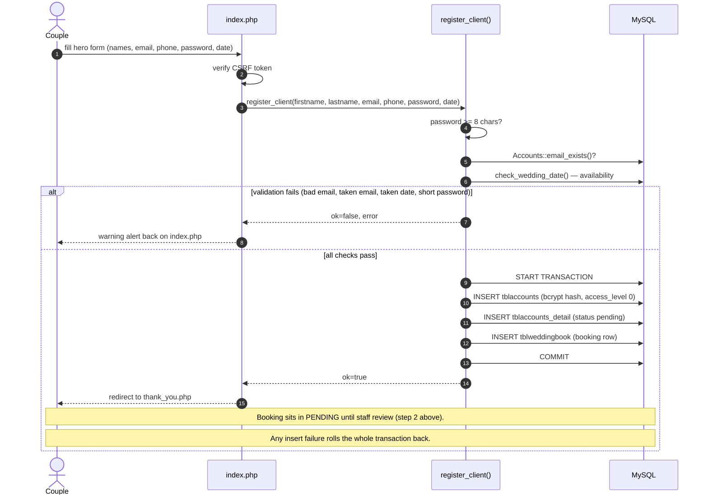
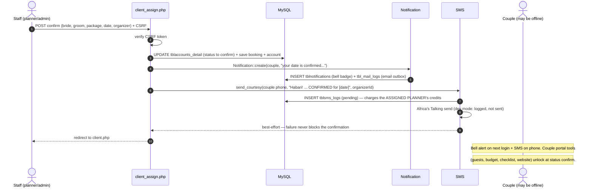
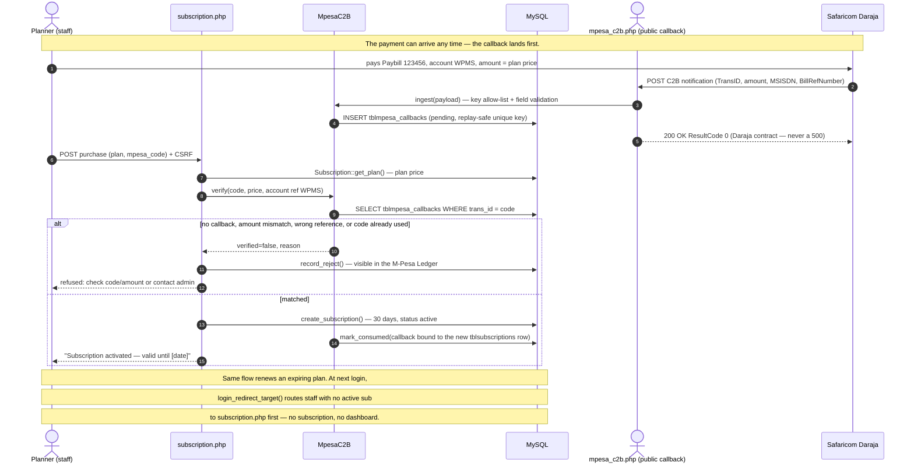

# Everafter Planner — How the System Works

A plain-English breakdown of the whole platform: who uses it, how their flows
connect, and how it makes money. For install steps see `README.md`; for
page-by-page detail see `WPMS_KENYA_MANUAL.md`.

---

## 1. The One-Sentence Summary

Everafter Planner is a Kenyan wedding-planning SaaS built in PHP/MySQL. Wedding
couples register their wedding on the public site; staff (planners and
admins) turn those registrations into managed bookings with packages, guest
lists, budgets, SMS reminders and public wedding websites; approved vendors
sell into those weddings through a marketplace; and the business earns from
staff subscriptions, vendor commissions, SMS credits and add-ons — with
M-Pesa (KSh) as the payment rail for everything.

```
Couples (public site)                Vendors (marketplace)
   │  register                          │  register → admin approval
   ▼                                    ▼
┌──────────────────────────────────────────────────────┐
│ STAFF BACK OFFICE (planners + super admins)          │
│ clients → bookings → guests/budget/calendar/gallery  │
│ SMS center · vendor ledger · subscriptions           │
└──────────────────────────────────────────────────────┘
   │                    │                       │
   ▼                    ▼                       ▼
Public wedding       SMS/e-mail               M-Pesa
websites (RSVP)      (Africa's Talking)       payments (KSh)
```

---

## 2. The Four Roles

Every role signs in through **one door** — `login.php` (the old
`admin/login.php` 301-redirects there). The system checks credentials first
against the client table (`tblaccounts`), then the staff table (`tblusers`),
then routes each account to its role's landing page.

| Role | Where they live | Access level | Lands on |
|---|---|---|---|
| **Super Admin** | `tblusers`, `access_level = 2` | Full system | `admin/dashboard.php` |
| **Wedding Planner** | `tblusers`, `access_level = 1` | Manage own clients | `admin/dashboard.php` (or `admin/subscription.php` first if no active subscription) |
| **Vendor Lead** | `tblusers`, `access_level = 0` | Own profile/packages/bookings | `admin/vendor_home.php` — their own bookings ledger; unregistered vendors start at `admin/vendor_register.php` |
| **Couple / Client** | `tblaccounts` (+ `tblaccounts_detail`) | Own bookings only | `admin/client.php` — their bookings dashboard |

### Capability matrix

| Capability | Super Admin | Planner | Vendor | Couple |
|---|---|---|---|---|
| Dashboard | ✅ | ✅ | ❌ | ❌ |
| Client management | ✅ all | ✅ own | ❌ | ❌ |
| Vendor marketplace | ✅ | ✅ | ✅ own | ✅ browse/enquire |
| SMS center | ✅ | ✅ (credits) | ❌ | ❌ |
| Subscription management | ✅ | ✅ own | ❌ | ❌ |
| Admin user management | ✅ | ❌ | ❌ | ❌ |
| Vendor approval | ✅ | ❌ | ❌ | ❌ |
| Blog / real-weddings showcase | ✅ | ❌ | ❌ | ❌ |
| Budget, guest list, calendar, gallery | ✅ all | ✅ own | ❌ | ❌ |
| Planning checklist, wedding website | — | ✅ preview | ❌ | ✅ own |

### The two account tables

- **`tblusers`** — staff and vendor leads. RBAC via `access_level`
  (`2` = super admin, `1` = planner, `0` = vendor).
- **`tblaccounts`** — couples. Always `access_level = 0` and never staff.
  Client pages re-check ownership on every request and scope every query to
  the signed-in account.

---

## 3. The Wedding Lifecycle (the core flow)

```
REGISTERED ──→ PENDING ──→ ASSIGNED ──→ CONFIRMED ──→ PLANNING ──→ WEDDING DAY
   (hero form     (admin      (admin        (admin        (tools)      (budget
    on index)     reviews)    fills in      sets confirm)              closed out)
                               package,
                               organizer)
        └──→ CANCELLED / FRAUD (from review stage)
```

**Step by step:**

1. **Couple registers** on the public `index.php` hero form. The system
   validates the input (email format, uniqueness, date availability), then
   creates the client account (`tblaccounts`), client details
   (`tblaccounts_detail`, status `pending`) and a booking row
   (`tblweddingbook`) in one pass. They land on a thank-you page.
2. **Staff reviews** — pending clients queue on `admin/client.php` (Pending
   tab), with a dashboard notification.
3. **Staff assigns** — via `admin/client_assign.php`: bride/groom names,
   package (`tblweddingcategories`), wedding date, venue, and the assigned
   organizer (`organizer_id`). Status moves to `confirm` and the couple
   unlocks their portal tools.
4. **Planning phase** — both sides work in parallel:
   - *Couple portal* (`admin/client.php` + sub-pages): guest list, budget
     view, planning checklist (auto-seeded with Kenyan milestones — ruracio,
     church banns, eCitizen, committee), vendor marketplace, wedding website.
   - *Staff console*: same data with edit rights, plus package management,
     calendar (`task_calendar.php`), gallery, and the vendor enquiry ledger.
5. **Payments tracked** throughout (`tbl_liquidation`): cash, M-Pesa (with
   transaction code), or bank transfer, per event. Deposit alerts fire to the
   assigned planner; deadline-band SMS (60/30/7 days out) chase the balance to
   the couple.
6. **After the wedding** — gallery is finalized, the real wedding can be
   showcased on the blog (`tblpostwedding`), and vendor bookings marked
   completed.

### 3.1 The three key flows as sequence diagrams

These mirror the actual code paths (helper names and tables are real).
GitHub renders Mermaid natively; most Markdown viewers (VS Code, GitLab)
do too.

#### Flow 1 — Couple registration (public hero form)



#### Flow 2 — Booking confirmation (staff assigns)



#### Flow 3 — Subscription purchase & renewal (M-Pesa verified)



> With `WPMS_MPESA_VERIFY` off (dev/demo), the verification branch in Flow 3
> is skipped and the code is accepted as typed — the ledger still records
> every payment Safaricom reports.

---

## 4. How the Money Works (Monetization)

Five active streams plus three planned ones. All amounts in KSh; all payments
collected via M-Pesa (Paybill, transaction codes verified automatically via
the Daraja C2B callback — §3.1 Flow 3).

### 4.1 Staff SaaS subscriptions (the anchor stream)

Planners/admins pay monthly to use the back office. Enforced at login:
`login_redirect_target()` checks `Subscription::get_active()` and routes
staff without an active subscription to `admin/subscription.php` **before**
anything else — no subscription, no dashboard.

| Plan | Price (KSh/mo) | Weddings | Includes |
|---|---|---|---|
| Starter | 2,999 | 3 / year | Guest list, budget tracker, basic calendar |
| Professional | 7,999 | Unlimited | All features, M-Pesa, SMS, gallery |
| Agency | 14,999 | Unlimited | Multi-user, white-label, API, priority support |

Flow: pick plan → M-Pesa modal (Paybill 123456, account `WPMS`) → enter the
M-Pesa transaction code → the code is **verified automatically** against the
payment Safaricom reported to `mpesa_c2b.php` (Daraja C2B callback, see §3.1
Flow 3 and manual §7.6; with `WPMS_MPESA_VERIFY` off — dev/demo — the code is
accepted as typed) → 30-day subscription row in `tblsubscriptions`. Renewals
repeat the cycle; lapses re-route staff to the subscription page on next
login. Every reported payment is visible in the M-Pesa Ledger
(`admin/mpesa_ledger.php`), where an admin can still accept a pending one
manually.

### 4.2 Vendor commissions (transaction revenue)

Couples browse the vendor marketplace (`admin/client_vendors.php`) and send
enquiries; planners confirm deals on the staff ledger
(`admin/vendor_enquiries.php`). The confirmed amount is stored with its
commission in `tblvendor_bookings.commission`.

- **Standard vendors: 10%** of booking value
- **Premium vendors: 15%** (they pay for the extra visibility — see 4.4)

### 4.3 SMS credits (usage revenue)

Bulk SMS (invitations, RSVP reminders, harambee thank-yous, transport and
payment-deadline texts) ride Africa's Talking, with **credits charged to the
assigned planner** per send.

| Package | Credits | Price (KSh) |
|---|---|---|
| Basic | 100 | 999 |
| Standard | 500 | 2,499 |
| Premium | Unlimited/mo | 4,999 |

Cost basis: 1 SMS = 160 chars, KSh 1 per segment (long texts split via
`ceil(len/160)`). Balances tracked in `tblsms_credits`; every send logged in
`tblsms_logs` with cost and status. Auto-reminders (RSVP nudges, deadline
bands) consume the same credits, so volume scales with weddings under
management.

### 4.4 Vendor premium listings (recurring)

Vendors pay **KSh 3,000/month** for priority listing, a "Premium" badge,
unlimited photos and analytics — and pay the higher 15% commission rate.

### 4.5 Wedding websites (per-wedding add-on)

Premium feature at **KSh 1,999 per wedding**: a public shareable page
(`site.php?slug=...`) with the couple's story, venue, countdown and gallery,
plus token-based RSVP links for guests.

### 4.6 Planned / expansion streams

| Stream | Model | Price range |
|---|---|---|
| White-label license | Setup + annual | KSh 150,000 – 500,000 |
| Data / analytics reports | Per report or subscription | KSh 5,000 – 45,000/yr |
| Marketplace take-rate growth | Commission tiers by volume | negotiable |

### 4.7 Revenue at a glance

| Stream | Type | Price point | Where enforced |
|---|---|---|---|
| SaaS subscription | Monthly recurring | KSh 2,999–14,999/mo | `Subscription::get_active()` at login |
| Vendor commission | Per booking | 10–15% | `tblvendor_bookings.commission` |
| SMS credits | Usage | KSh 1/SMS | `SMS::deduct_credits()` |
| Premium vendor | Monthly recurring | KSh 3,000/mo | `tblvendors.is_premium` |
| Wedding website | Per wedding | KSh 1,999 | `tblwedding_websites` |
| White-label | Setup + annual | KSh 150k–500k | roadmap |
| Analytics | Per report / annual | KSh 5k–45k/yr | roadmap |

### 4.8 Who pays what (worked example)

A single confirmed wedding on the Professional plan, three vendor deals
confirmed at KSh 80,000 each:

| Source | Amount (KSh) |
|---|---|
| Planner subscription (Professional, monthly) | 7,999 |
| Vendor commissions (3 × 10% of 80,000) | 24,000 |
| SMS spend (200 invites + reminders @ KSh 1) | 200 |
| Wedding website (premium add-on) | 1,999 |
| **Total attributed to one wedding** | **≈ 34,200** |

Against that one wedding the vendor packages sold were KSh 240,000 — the
platform's cut is ~10% of the transaction volume it hosts, plus the fixed SaaS
floor and usage fees.

---

## 5. Supporting Modules

| Module | What it does | Key files |
|---|---|---|
| Packages | 5 Kenyan packages priced KSh 50k–350k (Ruracio 150k, Church 250k, Civil 50k, Reception 350k, After-Party 100k) with features per package | `Categories.php`, `Features.php`, `package_*.php` |
| Guest list | Kenyan-specific: harambee contributions, upcountry/transport/accommodation flags, priority A–E (VIP→general), dietary needs | `Guest.php`, `guest_*.php` |
| Budget | Payment tracking by method (cash / M-Pesa / bank) with M-Pesa codes, per-event liquidation, couple-facing "Budget vs Actual" with harambee pledges | `Liquidation.php`, `budget_*.php` |
| Calendar | FullCalendar per booking, color-coded Kenyan event types | `Events.php`, `task_calendar.php` |
| Gallery | Photo uploads per booking | `Gallery.php`, `photos_*.php` |
| Notifications | In-app bell + email outbox (`tbl_mail_logs`), retried by `mail_retry.php`, pruned by `notify_prune.php` | `Notification`, `scripts/mail_retry.php` |
| Automation | Cron scripts: RSVP reminders (`rsvp_reminders.php`), payment deadline SMS (`deadline_sms.php`), mail retry, notification prune, demo reset | `scripts/` |
| Blog | Real-weddings showcase | `EventWedding.php`, `blog_events_*.php` |

---

## 6. Data Model Map (who links to what)

```
tblusers (staff, access_level 0/1/2)
   │ organizer_id
   ├──→ tblaccounts_detail ──→ tblaccounts (couples: access_level 0)
   │            │
   │            └─ user_id ──→ tblweddingbook (bookings)
   │                              │ booking_id
   │                              ├──→ tblguest        (guests + harambee)
   │                              ├──→ events          (calendar)
   │                              ├──→ tbleventbooking (event↔feature links)
   │                              ├──→ tblgallery      (photos)
   │                              ├──→ tbl_liquidation (payments, M-Pesa codes)
   │                              ├──→ tblwedding_websites (public site, slug)
   │                              ├──→ tblvendor_bookings (vendor deals, commission)
   │                              └──→ tblsubscriptions? no — subscriptions key on staff
   │
   └── staff-owned
        ├──→ tblsubscriptions (+ tblsubscription_payments, plans in tblsubscription_plans)
        ├──→ tblsms_credits / tblsms_logs
        ├──→ tblvendors (vendor profiles → tblvendor_packages)
        └──→ tblnotifications / tbl_mail_logs

tblweddingcategories (packages) ──→ tbl_features
tblpostwedding (real-weddings blog)
```

> Note: `tblsubscriptions.user_id` points at **staff** users (`tblusers`) —
> planners pay, couples don't.

---

## 7. Security & Session Model (what gates every role)

- **One login door** with CSRF-protected forms; credentials checked against
  `tblaccounts` first, then `tblusers` (bcrypt `password_verify`).
- **Session hardening**: ID regeneration on login and every 15 minutes,
  fingerprint binding, audit rows in `tblsession_audits`.
- **Role gating**: staff pages call `require_staff()`; client pages check
  `$_SESSION['id']` ownership and scope every query to the signed-in account.
- **Subscription gate**: staff without an active subscription are diverted to
  `admin/subscription.php` — the SaaS enforcement point.
- **PDO prepared statements** everywhere, CSRF tokens on all POST forms.
- **M-Pesa verification** is manual today (transaction codes checked by an
  admin); Daraja API-ready for automation.

---

## 8. Where Each Role's Money Touches the Code

| Role | Pays for | Enforced at |
|---|---|---|
| Planner (staff) | Monthly subscription | Login redirect + `admin/subscription.php` |
| Planner (staff) | SMS credits | `admin/sms_center.php`, `SMS::deduct_credits()` |
| Vendor | 10–15% commission per confirmed deal | `admin/vendor_enquiries.php` → `tblvendor_bookings` |
| Vendor | KSh 3,000/mo premium listing | `tblvendors.is_premium` |
| Couple | KSh 1,999 wedding website | `admin/client_website.php` |
| Couple | Wedding package price | `tbl_liquidation` payments (this is the *client's* spend, not platform revenue — the platform earns the SaaS/commission/SMS lines around it) |

---

## 9. Known Gaps & Roadmap

- **Vendor self-service is built** — `access_level 0` accounts land on
  `admin/vendor_home.php` (their own bookings ledger), with self-service
  profile, packages and registration pages; admin-managed fields (approval,
  premium, commission) stay behind a staff login (manual §9).
- **M-Pesa verification is automatic (C2B callback)** — codes typed on
  subscription/payment forms are checked against payments Safaricom reports
  to `mpesa_c2b.php` (Daraja C2B) when `WPMS_MPESA_VERIFY=1`; see manual §7.6.
- **STK push is built** — the app can also *initiate* payments: Daraja
  prompts the phone, the customer enters their PIN, and the result callback
  (`mpesa_stk_callback.php`) fulfils the subscription or books the deposit
  automatically, exactly once (manual §7.7). Without Daraja credentials the
  transport is simulated (dev/demo).
- **Login rate limiting is built in** — `login.php` throttles failed
  sign-ins per (email, IP) pair (5 failures → 15-minute lockout) with a
  wider per-IP cap, success-clear and prune (`LoginThrottle` class +
  `tbllogin_throttle`, `WPMS_LOGIN_THROTTLE_OFF=1` disables it). No server
  modules needed.
- **White-label and analytics revenue** are priced in the manual but not yet
  productized.
